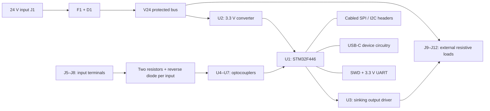

# A0 electrical design and decisions

Revision A0, 2026-10-24. Read with the [schematic](../../hardware/prototype-a/electronics/tinyplc-a0-schematic.pdf)
and [per-component register](prototype-a-components.md). This is an unrouted
electrical draft. Quantities and operating limits below are design assumptions
and calculations, not measured performance.

## Reading the schematic

The A1 sheet is a circuit atlas grouped into power, MCU, four input channels,
outputs, USB and expansion. A short wire from a pin to a net label connects
that pin to every identical label on the sheet. `GND` is the shared return;
`+3V3` is regulated logic power; `V24` is fused, reverse-polarity-protected
power. `VIN24` is the unprotected input. A name ending `_N` is active-low.
Crosses on pins mean intentionally unconnected, not a missing wire.

The footprint field points to a project-local package snapshot. Each placed
symbol also has MPN, Purpose, Datasheet and Status fields. Reference designators
identify physical items; `R10` in the schematic, BOM and component guide is the
same item. Test pads and mounting holes are board features, not purchased ICs.

## E01 — Keep the existing processor

U1 is STM32F446RET6, LQFP64. Keeping this CPU preserves the compiler's ARM target,
memory capacity and existing protection architecture. A different PCB is still
a new firmware target: the old Nucleo binary is not an accepted board image.
Package pin allocation was taken from the KiCad STM32 symbol and must be
reviewed against [ST DS10693, pin descriptions and power-supply scheme](https://www.st.com/resource/en/datasheet/stm32f446re.pdf).

C4–C7 are four 100 nF VDD bypasses, C9 is local bulk, and VBAT is tied to 3.3 V
because A0 has no battery domain. C8 is **4.7 µF** on VCAP_1 to ground. The
LQFP64 package has a single VCAP pin: DS10693 Table 18 calls for 4.7 µF for
that case. VCAP must never supply external circuits. Select its actual ceramic
part by effective capacitance and ESR, not the nominal label alone.

R1 (22 Ω), C10 (100 nF) and C11 (1 µF) filter VDDA. At an assumed 1 mA analog
supply current R1 drops 22 mV; verify the worst-case current and voltage
relationship to VDD before release. No external analog I/O is provided.

## E02 — Supply and protection scope

J1 pin 1 is VIN24, pin 2 GND. F1 is a 500 mA-hold MF-R050 PTC; D1 is an SS16
series Schottky diode. F1 helps with sustained overloads, with trip behavior
strongly dependent on ambient temperature. It is not a fast per-output current
limiter. D1 blocks reverse input polarity at the cost of voltage drop and heat.
[Bourns MF-R data](https://www.bourns.com/docs/product-datasheets/mf-r.pdf) and
[Diodes SS1x data](https://www.diodes.com/datasheet/download/ds13003.pdf) control
the final ratings and footprints.

U2 is a [TRACO TSR 1-2433](https://www.tracopower.com/tsr1-datasheet), a switching
converter feeding 3.3 V directly. A module reduces the number of switching
layout decisions in the first board. Pin 1 is VIN, 2 GND, 3 VOUT. C1 (22 µF,
50 V, polarized) provides an input reservoir; C2 adds high-frequency bypass;
C3 is local output bulk. Follow the converter's permitted external capacitance
and startup guidance when exact capacitors are selected.

There is deliberately no unqualified 28/33 V TVS fitted across this supply.
A TVS standoff rating is not its clamping voltage; it can clamp above a
36 V-rated converter's limit. A0 assumes a regulated, current-limited bench
source. Field surge/ESD protection needs a separate coordinated design before
field wiring or an expanded input-voltage claim.

Provisional power allocation: MCU 150 mA, Ethernet allowance 200 mA, display
30 mA, other logic 20 mA = 400 mA at 3.3 V, or 1.32 W. These are design
allocations, not guaranteed device maxima. At 85% assumed conversion efficiency
and 21.6 V input the logic input estimate is 72 mA. Four 50 mA loads add 200 mA,
giving roughly 272 mA through the protected bus before other losses. Recompute
from actual parts, duty cycles, PTC derating and measurements before setting
current limits. The module's nominal 1 A capability is not a board current rating.

## E03 — Input path, demonstrated with DI1

Connect a bench signal between J5 pin 1 and J5 pin 2 (GND). Current flows through
R10 and R11, then the LED inside U4, to ground. Light makes U4's transistor pull
`DI1_N` low. R12 returns the GPIO high when the input is absent. C21 filters the
collector node. D11 is antiparallel to the LED: its cathode faces the LED anode,
so a reversed signal bypasses the LED through the two limiting resistors.
The other three channels repeat the same topology.

- Assuming LED forward voltage 1.2 V, the nominal 24 V current is
  `(24 - 1.2) / (2200 + 2200) = 5.18 mA`.
- At 26.4 V and resistor values 1% low, the current estimate is 5.79 mA.
  Each 2.178 kΩ resistor dissipates about 73 mW. Check resistor temperature
  derating, actual LED drop and reversed-input dissipation.
- A 10 kΩ pull-up needs about 0.33 mA collector current to pull low.
- The RC release time constant is approximately `10 kΩ × 10 nF = 100 µs`.
  This does not provide a specified switching threshold or Schmitt hysteresis.

The selected optocoupler is [Vishay VO617A-3](https://www.vishay.com/docs/83430/vo617a.pdf).
The borrowed four-pin KiCad graphic is based on LTV-817, with the same proposed
1=A, 2=K, 3=E, 4=C mapping. The displayed value and BOM specify VO617A-3.
Review this equivalence against the actual ordered package. CTR guarantees at
specified current/temperature do not automatically cover the whole proposed
input range. Measure turn-on/off levels, leakage sensitivity, filter delay and
temperature behavior. No IEC input-class compliance is claimed.

Both sides share `GND`, including the non-isolated converter. **The board is not
galvanically isolated**, despite using optocouplers. This choice gives a simple
input-conditioning experiment and can be revisited for a truly isolated revision.

## E04 — Outputs sink current

[U3, TPL7407LDR](https://www.ti.com/lit/ds/symlink/tpl7407l.pdf), contains seven
NMOS low-side channels compatible with low-voltage GPIO drive; four are used.
The exact part is **TPL7407L, not TPL7407LA or ULN2003LV**. These parts have
different limits. A project-owned symbol records the TI pinout explicitly.

For Q1 connect the load between J9 pin 1 (`V24`) and pin 2 (`Q1`). Driving PB0
high lets current flow from V24 through the load into U3 and ground. This is a
sinking output, not a 24 V sourcing output. The output node floats when off.
An initial 4.7 kΩ, at least 0.25 W resistor is a suitable *calculated test load*:
about 5.1 mA and 123 mW at 24 V. Use the bench current limit.

U3 pin 9 (COM) connects to V24 and C30; its internal clamp diodes return
inductive energy to that bus. Initial testing is resistive. Clamp diodes do not
establish a tested inductive energy rating or protect against short circuits.
F1 does not protect an individual channel rapidly. Initial 50 mA/channel and
200 mA total limits are test targets pending thermal and fault testing.

R51–R54 provide 100 kΩ input pull-downs in addition to the chip's internal ones.
Unused inputs 5–7 are grounded; unused outputs are NC. Firmware must initialize
PB0/PB1/PB8/PB9 low before enabling outputs. PB4 was deliberately avoided because
its reset-time debug function/pull-up could conflict with an OFF command. Reset, ROM boot, fault handling
and power ramps must be measured at the actual terminals. A separate hardware
output-enable interlock is an unresolved future decision.

## E05 — Clock, boot and debug

Y1 is an 8 MHz [Abracon ABM3 crystal](https://abracon.com/Resonators/abm3.pdf).
C13/C14 are provisional 27 pF C0G loading capacitors. For equal capacitors,
`CL ≈ C/2 + Cstray`, so 27 pF assumes around 4.5 pF parasitic capacitance for
an 18 pF crystal. Confirm crystal ordering code, ESR, MCU oscillator gain and
startup margin using ST oscillator guidance; tune after layout. The Nucleo's
ST-LINK-supplied clock is absent. Firmware must select crystal mode rather
than blindly retaining the old external-clock bypass configuration.

R2/C12 and SW1 pull/filter/assert NRST. R3 pulls BOOT0 down; J2 can momentarily
connect BOOT0 to 3.3 V for ROM recovery. R4 pulls PB2/BOOT1 low. No shunt is
installed in normal operation. J3 is a custom 6-pin SWD header, not a standard
ARM 10-pin cable. Its pin 1 is target voltage reference, not permission to power
the board from a programmer. J3 pin 6 is deliberately NC. J4 supplies the
existing UART protocol path (115200 8N1) with 3.3 V levels and common ground.

SW2 and R5 provide an active-low PC13 user button. D2 and R6 provide the PA5
status LED. PA5 is deliberately kept out of SPI expansion to retain a familiar
LED bring-up path. Button debounce and the meaning of RUN/STOP remain firmware
work; SW2 is not currently a RUN/STOP implementation.

## E06 — USB hardware versus implemented transport

J13 is [GCT USB4105](https://gct.co/files/drawings/usb4105.pdf), a USB2 Type-C
receptacle. R60 and R61 are independent 5.1 kΩ Rd resistors on CC1/CC2.
R62/R63 are provisional 22 Ω series resistors. U8 is
[ST USBLC6-2SC6](https://www.st.com/resource/en/datasheet/usblc6-2.pdf), with C31
on its VBUS reference. USB shield is tied directly to ground for this bench
revision; chassis/ESD return design remains a review item.

R64/R65 divide VBUS to PA9: at 5 V the sense voltage is about 2.98 V, and at
5.25 V about 3.125 V nominal. Confirm resistor tolerance, GPIO maximum voltage,
unpowered pin injection limits and the firmware sensing method. The board
cannot be powered from USB. Firmware must attach only while board power and
VBUS are present and must detach when VBUS disappears. Native USB CDC and any
USB bootloader path have not been implemented or tested in this repository.
Use J4 for first engineering communication.

Two copper layers are a preliminary layout target. The USB connector footprint
has tightly spaced alignment holes: the draft board minimum hole-to-copper
clearance is 0.15 mm, with roughly 0.194 mm around its locating holes. A real
fabricator must accept this before release. Signal clearance is provisionally
0.2 mm; 0.25 mm is the default signal track width, not a power-trace rating.
Routing, planes, return paths, USB impedance and trace sizing remain unfinished.

## E07 — Expansion is cabled and optional

J14 carries 3V3/GND/SCK/MISO/MOSI/CS from SPI2. J15 carries GND/RST/INT.
R70 keeps CS deasserted; R71 keeps Ethernet reset asserted; R72 pulls INT high.
The [WIZ850io documentation](https://docs.wiznet.io/Product/ioModule/WIZ850io)
is the official reference for a candidate module. J14/J15 are **not** its
direct mating pattern. That manufacturer's page currently contains conflicting
outline dimensions, so no module outline is frozen into the case. A selected
module needs an adapter/cable drawing, retention, connector aperture, supply
checks and firmware before it is added to the assembly BOM.

J16 carries 3V3/GND/SCL/SDA; R73/R74 are 4.7 kΩ pull-ups. A possible display is
[Adafruit product 326](https://www.adafruit.com/product/326). Its actual interface
configuration, mounting-hole drawing, pull-ups and connector order must be
checked before designing its bracket. The case currently has a removable blank.

Persistent downloaded-program storage is also deferred: the existing runtime
loses downloaded applications on reset. No external flash is fitted in A0.

## Proposed physical pin allocation

| Function | MCU pin(s) | Electrical meaning |
| --- | --- | --- |
| DI1, DI2, DI3, DI4 | PA0, PA1, PA4, PA6 | Active-low raw inputs; invert in the board port |
| Q1, Q2, Q3, Q4 | PB0, PB1, PB8, PB9 | High commands sinking output ON |
| Engineering UART | PA2 TX, PA3 RX | 3.3 V USART2, custom J4 header |
| SWD | PA13, PA14, NRST | Reserve from application logic |
| User / LED | PC13 / PA5 | Button active-low / LED active-high |
| USB | PA11 D-, PA12 D+, PA9 sense | New device firmware required |
| Ethernet candidate | PB12 CS, PB13 SCK, PB14 MISO, PB15 MOSI, PA10 reset, PA8 interrupt | SPI2, cabled |
| Display candidate | PB6 SCL, PB7 SDA | I2C1, cabled |
| Recovery | BOOT0, PB2 BOOT1 | Strap inputs; not application outputs |

No production board profile or firmware target is installed by this CAD change.
That is a separate integration task after electrical review.
