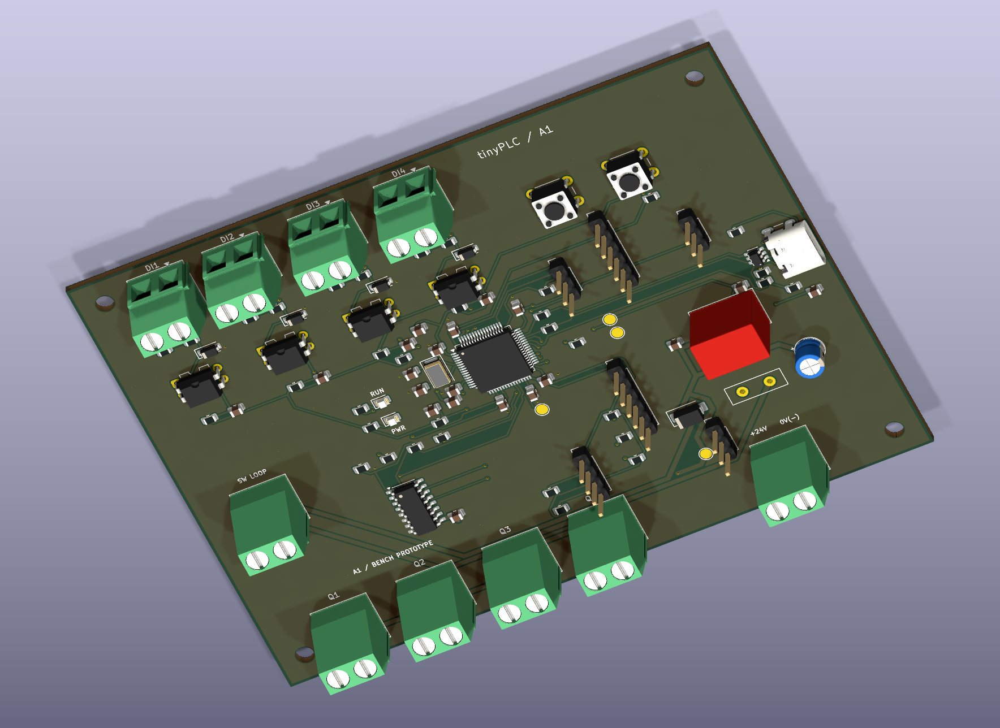

# A1 routed prototype PCB

The custom A1 controller now has copper routing. Open
[the KiCad board](../../hardware/prototype-a1/electronics/tinyplc-a1.kicad_pcb)
or [the project](../../hardware/prototype-a1/electronics/tinyplc-a1.kicad_pro).
The [verification report](../../hardware/prototype-a1/reports/verification.md)
records the native ERC, DRC, schematic parity and independent pin checks.
No DRC exclusions or unconnected-net suppressions are used.



## What changed electrically

The placement draft accidentally assigned DI1 to PA1, which was already assigned
to DI2. The duplicate dictionary key silently removed DI1 from U1. This revision
restores **DI1 → PA0, package pin 14**. Verification now independently checks all
four inputs, four outputs, supply pins and principal interfaces against their
intended package pins, and rejects duplicate literal dictionary keys.

C15 adds a local 100 nF bypass for VBAT, which is connected to +3V3. C4–C7 now
sit near their respective VDD connections. C8 moves beside VCAP1, pin 30, and
retains 4.7 µF: the single-VCAP package requires that value with ESR below 1 Ω
according to [ST DS10693, table 18](https://www.st.com/resource/en/datasheet/stm32f446re.pdf).
C10/C11 and R1 serve the analog supply. These are decoupling and placement
changes, not new software features. Exact capacitor purchasing choices remain
subject to DC-bias, tolerance and ESR review.

The crystal and its load capacitors move beside PH0/PH1. The reset pull-up,
boot resistors, USB damping resistors, SWD header and selected small parts move
to make room. The switch-loop terminal, external connectors, PCB outline,
mounting holes and two optical LED locations retain their enclosure interfaces.
The FreeCAD assembly and affected Blender views are regenerated from these
positions. The component register also repairs malformed Panasonic and Omron
datasheet URLs inherited from the earlier revision rename. C1 now uses the
5 mm body / 2.0 mm lead-pitch footprint for Panasonic EEU-FR1H220; the prior
6.3 mm / 2.5 mm footprint did not match. Its mechanical envelope allows the
manufacturer’s +0.5 mm diameter and +1.5 mm height tolerances. See the
[FR datasheet](https://industrial.panasonic.com/cdbs/www-data/pdf/RDF0000/ABA0000C1259.pdf).
The existing C1 routes were retained and rechecked against the corrected pads;
the saved SES component identifier was updated accordingly.

## Layer and routing decisions

| Item | Decision and reason |
| --- | --- |
| Board | Two copper layers, 120 × 90 × 1.6 mm; preserves the A1 enclosure |
| Ordinary signals | Nominal 0.25 mm; minimum used 0.20 mm at dense escapes |
| Ordinary copper clearance | 0.20 mm minimum |
| Positive supply path | VIN24, VIN_FUSED, VIN_SWITCHED and V24 use 0.80 mm traces and a 0.30 mm net-class clearance |
| Vias | Through vias, 0.60 mm diameter / 0.30 mm drill |
| Ground | GND pours on both copper layers, 0.25 mm pour clearance; disconnected islands removed |
| Ground solder joints | Solid connections on small SMD pads; thermal relief on through-hole grounds for hand soldering |
| Mounting | Existing four M3 non-plated mounting holes retained |
| Board status | Bench prototype candidate; no physical validation or fabrication release |

The wider positive-supply traces follow the shared input and load supply path.
They do **not** establish a current rating: F1 behavior, connector contacts,
via barrels, copper weight, driver dissipation and enclosure temperature still
require review and bench measurements. The existing 50 mA/channel starting
target remains provisional. GND is the common 0 V return, not protective earth;
the optocouplers do not create galvanic isolation in this shared-ground circuit.

The 8 MHz oscillator routes and local supply bypass connections are explicitly
laid out before general routing. The clock traces stay on the top layer, with
short branches to the crystal and load capacitors. A bottom-layer routing
keepout under the clock allows ground copper while excluding other tracks and
vias. Load capacitance remains a starting value to be checked on real hardware.
See [ST AN2867, oscillator design](https://www.st.com/resource/en/application_note/an2867-oscillator-design-guide-for-stm8afals-stm32-mcus-and-mpus-stmicroelectronics.pdf).

USB D+/D− run from the MCU through nearby R63/R62, along adjacent top-layer
traces, through U8 and into J13. The main parallel section uses 0.25 mm traces
with 0.25 mm edge spacing. Bottom-layer tracks are excluded below that section
to preserve the ground return. The connector fanout connects both USB-C
orientations. U8's VBUS reference uses a short via beneath its body; USB VBUS
still does not power the board. The final connector fanout is entirely on the
top layer. The routing is for USB full speed, not USB high speed.

This is **not a verified 90 Ω differential design**: no fabrication stackup or
field-solver result has been selected. The connector escapes and source
resistor transitions are not uniformly coupled. Review the chosen stackup,
series damping and USB signal integrity before relying on the native USB port;
UART and SWD remain the initial bring-up interfaces. Refer to
[ST AN4879](https://www.st.com/resource/en/application_note/an4879-introduction-to-usb-hardware-and-pcb-guidelines-using-stm32-mcus-stmicroelectronics.pdf)
and [the USBLC6-2 datasheet](https://www.st.com/resource/en/datasheet/usblc6-2.pdf).

The remaining connections use local Freerouting 2.5.0, followed by KiCad import,
explicit cleanup, ground filling and native DRC. The router narrowed some pad
escapes below the configured minimum; the import script widens them to 0.20 mm
and the finished board is checked again. Unused fanout vias are removed. One
redundant ground trace is replaced by the ground pour to accommodate the ESD
reference connection. The final KiCad DRC, rather than the router's completion
status, determines whether all connections and clearances pass.

## Reproduce and edit

The generator creates a placement board. `route_pcb.py seed` adds the critical
routes and layer keepouts, sets the power net class, and writes a Specctra DSN
and exact seed board. `route_pcb.py import` imports the saved SES into that seed,
applies the documented cleanup and restores installed KiCad package models.
`route_pcb.py fill` fills both ground pours. To reproduce the current geometry:

```sh
python3 hardware/prototype-a1/scripts/generate_electronics.py
python3 hardware/prototype-a1/scripts/route_pcb.py seed
python3 hardware/prototype-a1/scripts/route_pcb.py import
python3 hardware/prototype-a1/scripts/route_pcb.py fill
python3 hardware/prototype-a1/scripts/generate_mechanics.py
python3 hardware/prototype-a1/scripts/verify.py
```

The saved [routing exchange files](../../hardware/prototype-a1/electronics/routing/)
avoid requiring the autorouter to reproduce the checked result. The manifest
records tool provenance and hashes. Freerouting is an external build tool, not
a redistributed executable. See its [official release](https://github.com/freerouting/freerouting/releases/tag/v2.5.0)
and [CLI documentation](https://github.com/freerouting/freerouting/blob/v2.5.0/docs/command_line_arguments.md).

If parts, nets, constraints or placement change, reroute and review them; do not
blindly replay this SES or its coordinate-specific cleanup onto another board.
Direct KiCad edits are valid, but regeneration overwrites them. Save a new
revision or update the routing sources before regenerating. The original
unrouted files remain in `electronics/archive-unrouted/` only as historical
evidence and contain the original DI1 error.

## Before ordering and powering a board

Review the schematic and layout independently, resolve the remaining component
SKUs, and agree the layer stackup/copper weight and manufacturing constraints
with the board supplier. Generate and inspect fabrication files from the
reviewed board. No board order or purchase has been placed by this work.
DRC checks geometry and connectivity; it does not prove surge immunity,
electrical ratings, thermal behavior, USB compliance or correct firmware.

Follow the [staged assembly and bring-up procedure](prototype-a1-assembly.md).
Start with the supply rails and SWD, then test one input/output at a time with
limited current. The A1 firmware port, OLED interface and RUN logic remain
unimplemented and the display renders remain marked DEMO. The shell still
needs a physical fit check using the coupon and actual components.
