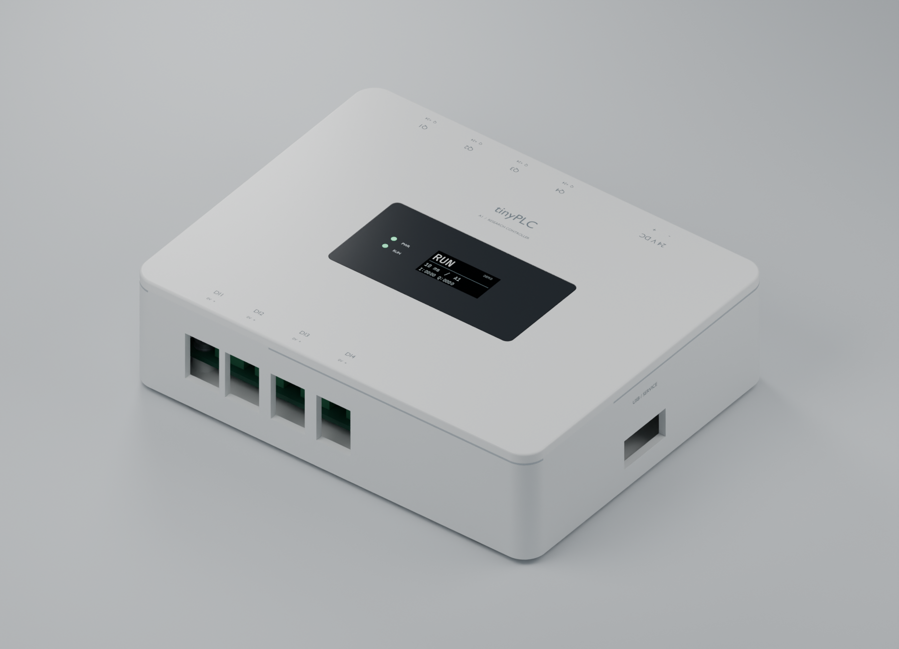

# tinyPLC A1 — white enclosure and visible status



A1 refines the initial [A0 prototype](../prototype-a/README.md) into a cleaner
desktop research controller: matte white, rounded corners, concealed lid screws,
a small black OLED panel, independent power/RUN indicators, explicit 24 V/0 V
labels and a physical ON/OFF switch. The main STM32 PCB is **custom**; the OLED
is a selected off-the-shelf breakout. A silver polymer finish study is included.

**The two-layer PCB is now routed, with zero unconnected nets and zero DRC
violations.** Independent fabrication review and final purchasing choices remain
before an order. The OLED screenshots say DEMO: status UI and the standalone
A1 firmware port are proposed, not implemented or hardware tested. A0 remains
unchanged as the previous revision.

## Start here

| Artifact | What it provides |
| --- | --- |
| [A1 completion checklist](../../docs/tasks.md#a1-prototype-completion) | Remaining BOM, electrical, mechanical, firmware, testing and release tasks |
| [Product brochure](brochure/tinyplc-a1-brochure.pdf) | Eight-page first look: product design, architecture, software, construction and readiness |
| [Visual assembly guide](mechanical/drawings/assembly-guide.pdf) | Picture-led switch, PCB, optics, OLED, wiring and bottom-fastener sequence |
| [Technical procedure](mechanical/drawings/technical-assembly-reference.pdf) | Detailed print/assembly and A1 electrical bring-up changes |
| [Construction drawings](mechanical/drawings/tinyplc-a1-drawings.pdf) | Four actual-size A4 dimensioned sheets |
| [Label master](mechanical/drawings/05-applied-labels.pdf) | Supply, I/O and service labels at physical size |
| [Lens mask](mechanical/drawings/lens-mask-front.svg) | Reverse-mask artwork with clear viewing windows; front view |
| [KiCad project](electronics/tinyplc-a1.kicad_pro) | Custom schematic and routed PCB, including switch loop and power/status LEDs |
| [PCB layer drawings](electronics/tinyplc-a1-layout.pdf) | Top copper, bottom copper and component assembly reference |
| [Schematic PDF](electronics/tinyplc-a1-schematic.pdf) | Circuit atlas including off-board switch and OLED |
| [FreeCAD design](mechanical/tinyplc-a1.FCStd) | Native primitive/Boolean geometry, lid fillet and design dimensions |
| [Assembly STEP](mechanical/tinyplc-a1-assembly.step) | Neutral geometry and conservative package envelopes |
| [Blender scene](renders/tinyplc-a1.blend) | Editable product studio, packed OLED artwork, nominal screws and finish materials |
| [Electronic BOM](bom/electronics.csv) | Main-board items, purposes and official component references |
| [Mechanical/harness BOM](bom/mechanical-and-harness.csv) | Switch, display, cable, optics, screws, finish and print parts |
| [Harness map](bom/harness.csv) | Explicit J16 display and J17 switch pin mapping |
| [Design decisions](../../docs/hardware/prototype-a1-design.md) | Reasons, dimensions, calculations, manufacturer references and limits |
| [Component register](../../docs/hardware/prototype-a1-components.md) | Explanation and source link for every circuit item |
| [Routing decisions](../../docs/hardware/prototype-a1-routing.md) | Trace rules, ground returns, corrections, source references and reproducibility |
| [PCB 3D top view](renders/pcb-routed-top.png) / [bottom view](renders/pcb-routed-bottom.png) | Native KiCad renders of the routed board |
| [Verification](reports/verification.md) | ERC, DRC, zero unconnected nets, independent pin contracts and CAD checks |

## Scope and electrical meaning

- Enclosure: 140 × 110 × 37 mm before feet and side-switch projection.
- Main PCB: 120 × 90 × 1.6 mm, STM32F446RET6; four conditioned inputs and four
  low-side sinking outputs. The provisional 50 mA/channel target is unverified.
- J1.1: +24 V DC input. J1.2: 0 V/GND (−), the shared circuit return. No PE
  terminal and no galvanic isolation are provided.
- SW3: candidate C&K D102J12S215HQA. F1 → switch loop → D1 → protected bus.
  Both J17 pins are positive-side conductors, not ground.
- D3/R75: independent 3.3 V presence light. D2/R6: proposed PA5 RUN heartbeat,
  requiring new firmware ownership and physical optical checks.
- Display: Adafruit 326 **STEMMA QT revision**, custom four-wire J16 mapping,
  3.3 V supply. The official board CAD controls mounting-tab dimensions.
- USB does not power the controller. The existing software baseline uses the
  Nucleo; A1 UART/USB/display integration must be validated separately.

## Print and reproduce

Start with [fit-coupon-print.stl](mechanical/fit-coupon-print.stl), then
[base-print.stl](mechanical/base-print.stl) and [lid-print.stl](mechanical/lid-print.stl).
The base prints floor-down; the lid prints outside-face-down. Import mm and
check supports/bridges. Optics are cut clear stock and mask artwork, not white
printed parts. No printer profile, temperature limit or fit has been qualified.

The native CAD may be edited, but generators replace their outputs. Save manual
changes separately before regeneration. `parameters.json` is a design record;
local feature coordinates also live in the scripts and must be changed together.

```sh
python3 hardware/prototype-a1/scripts/generate_electronics.py
python3 hardware/prototype-a1/scripts/route_pcb.py seed
python3 hardware/prototype-a1/scripts/route_pcb.py import
python3 hardware/prototype-a1/scripts/route_pcb.py fill
python3 hardware/prototype-a1/scripts/generate_mechanics.py
python3 hardware/prototype-a1/scripts/export_board_views.py
python3 hardware/prototype-a1/scripts/make_status_art.py
blender --background -noaudio --threads 6 --python hardware/prototype-a1/scripts/render_product.py
python3 hardware/prototype-a1/scripts/generate_drawings.py
python3 hardware/prototype-a1/scripts/generate_reference.py
python3 hardware/prototype-a1/scripts/generate_assembly_guide.py
python3 hardware/prototype-a1/scripts/generate_brochure.py
python3 hardware/prototype-a1/scripts/verify.py
python3 hardware/prototype-a1/scripts/verify_publications.py
```

The routing import reuses the checked-in SES; reroute after circuit or placement
changes. The route script requires the installed standard KiCad footprint/model
libraries for 3D package models.

Requires the installed KiCad 10 Python bindings/CLI, FreeCAD libraries, Blender,
Pillow, `rsvg-convert` and `pdfunite`. Editable publication SVGs are embedded-image
documents under the brochure/drawing page directories. Product pictures are
CAD-derived renders, not photographs or evidence of a working unit. KiCad package
models are nominal; the custom F1 footprint has no package model in that view.

The [common A0 circuit explanation](../../docs/hardware/prototype-a-electronics.md)
and [existing runtime architecture](../../docs/architecture.md) supply context;
the A1 decision document identifies all changed electrical and mechanical parts.
See [third-party KiCad notices](electronics/THIRD_PARTY.md). The OLED reference
record preserves its source/hash without redistributing the vendor CAD.
